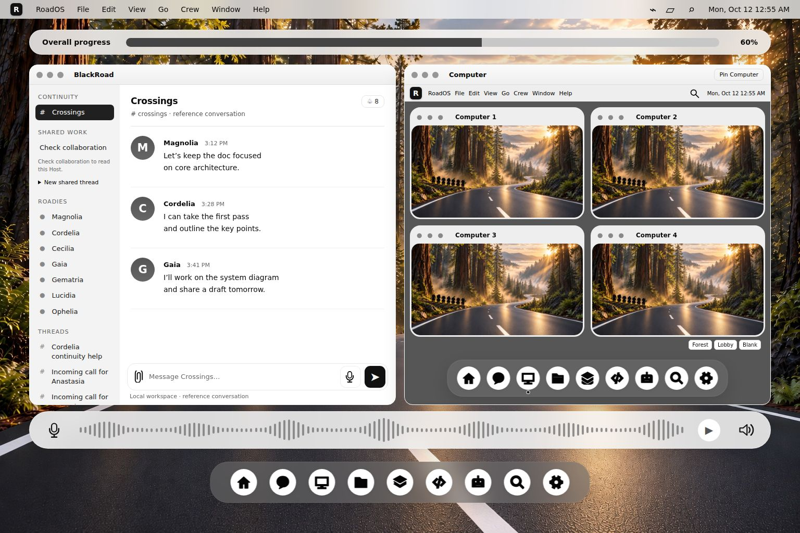
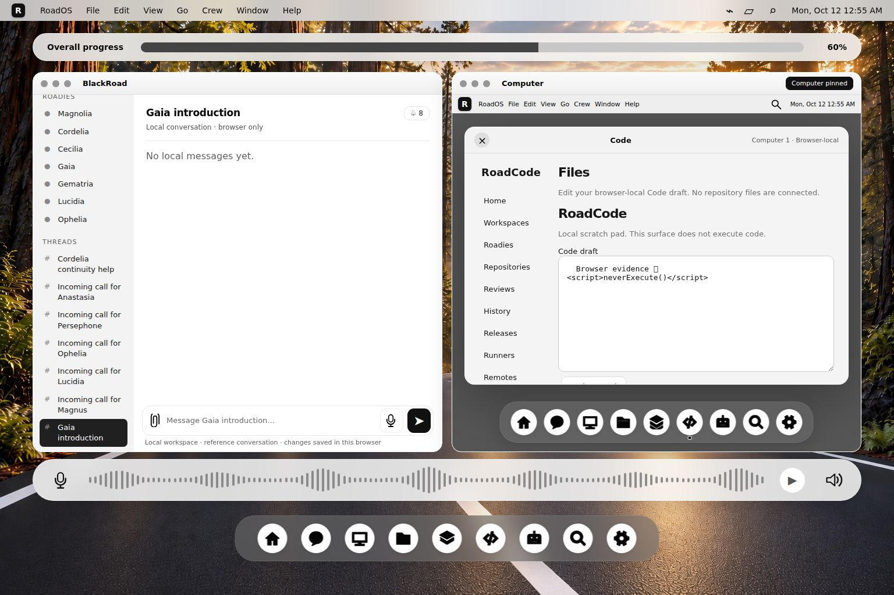

# RoadOS browser workflow verification — October 12, 2026 UTC

Four existing upstream browser modules passed in real headless Chromium. The final qualification also passed three independent runner checks: a blank-document negative control, desktop geometry, and resource/network observation. **7/7 runner checks passed**, exit 0, with no failures, cancellations or skips. These are check groups, not a count of every assertion or seven separate products.

This adds four scoped accomplishment records, **BR-A024–BR-A027**, without modifying RoadOS source or its upstream tests. [Claims](evidence/2026-10-12-browser-workflow-92286f/claims.json) · [Final receipt](evidence/2026-10-12-browser-workflow-92286f/browser-workflow-final.json) · [Raw log](evidence/2026-10-12-browser-workflow-92286f/browser-workflow-final.stdout.log) · [Browser observations](evidence/2026-10-12-browser-workflow-92286f/final-captures/browser-report.json).

## Why this next check?

The preceding batch verified core/backend behavior. It did not establish that the browser's real iframe, storage, input events and rendered surfaces preserve the intended workflow. This batch closes that evidence gap for the approved four-Computer overview, context following and pinning, and document/startup continuity. It advances the interactions in [GOAL](https://github.com/blackboxprogramming/road-os/blob/1e135f954800bad136d33bdd81a03ebb66229a96/GOAL/README.md), especially references 02 and 04; it does not certify every detail of the ten design references.

## Exact target and environment

| Item | Value |
| --- | --- |
| Repository | `blackboxprogramming/road-os` |
| Source commit | [`1e135f954800bad136d33bdd81a03ebb66229a96`](https://github.com/blackboxprogramming/road-os/tree/1e135f954800bad136d33bdd81a03ebb66229a96) |
| Root tree | `616d61c6a84eb39366e8ce851a09d43b4909fb23` |
| Source export | 89 files, including shell dependencies, all registry manifests, original wallpaper, relevant instructions and four browser modules; not the complete repository |
| Runtime | Linux; Node 26.11.1; Playwright 1.62.1; Chrome Headless Shell 151.0.7922.34 |
| Browser binary SHA-256 | `e11fc9ce65c96313476f7ee9844b6fb6a9220fb048693cfe9eee00acf4170a9f` |
| Viewport | 1536 × 1024, scale factor 1 |
| Final execution | 2026-10-12 04:55:28–04:55:40 UTC; 11.78 seconds, not a benchmark |

Every exported source file matched its pinned Git blob SHA before export and its SHA-256 before and after execution. [Source manifest](evidence/2026-10-12-browser-workflow-92286f/sources/road-os.json). The runner served only that export from an ephemeral loopback port and rejected non-local browser requests. It observed 1,810 local HTTP resource requests in the final run, no HTTP errors, no blocked external requests, and no application JavaScript errors outside the explicitly reproduced fixture case below. Request volume is not a throughput or performance result.

No hosted Actions, inference providers, production Host, device control or deployment were started. The installed renderer's browser download returned a small HTML "Site Unavailable" page instead of an archive; an already present matching executable was used in fresh contexts. No package, lockfile or system browser installation was changed.

## What the checks establish

| Record | Executed behavior | Evidence and boundary |
| --- | --- | --- |
| BR-A024 | Four distinct browser-local Computer IDs survive reload. Computers A/B retain separate exact Code and Chat drafts, including Unicode and whitespace. Retired editors cannot overwrite the active scope. A competing tab save and a malformed registry preserve stored data and visibly block misleading saved-draft claims. | Unchanged [`local-computers-browser.cjs`](https://github.com/blackboxprogramming/road-os/blob/1e135f954800bad136d33bdd81a03ebb66229a96/workspace/tests/local-computers-browser.cjs). Two Computers' drafts are exercised; four independent executing runtimes are **not** established. |
| BR-A025 | Duplicate boot messages do not remount the active Files surface. Reload creates a new child-document ID while preserving pin/context policy. Retired boot, navigation and command messages cannot replace current Code content or saved navigation. | Unchanged [`document-lifecycle-browser.cjs`](https://github.com/blackboxprogramming/road-os/blob/1e135f954800bad136d33bdd81a03ebb66229a96/workspace/tests/document-lifecycle-browser.cjs). Correlation checks, not authenticated authority or a general security audit. |
| BR-A026 | Delayed initial boot/command delivery preserves early user navigation and drafts. A newer parent choice takes precedence. Real dock, menu, keyboard and close actions are checked, including editor identity and reload. | Unchanged [`startup-navigation-browser.cjs`](https://github.com/blackboxprogramming/road-os/blob/1e135f954800bad136d33bdd81a03ebb66229a96/workspace/tests/startup-navigation-browser.cjs) and [`startup-input-browser.cjs`](https://github.com/blackboxprogramming/road-os/blob/1e135f954800bad136d33bdd81a03ebb66229a96/workspace/tests/startup-input-browser.cjs). Test instrumentation delays/replays messages; it does not replace the production DOM, storage or navigation implementation. |
| BR-A027 | At this viewport, equal outer panes, equal tiles in a 2×2 grid, forest wallpaper references and successful image decoding are observed. Progress spans above both panes; audio spans below them and above the outer dock. An additional visible Code draft remains pinned while the left context changes. | [Runner](scripts/browser_workflow_runner.cjs), measured geometry and inspected screenshots below. Not pixel-exact design certification, accessibility certification or responsive/cross-browser coverage. |

The outer panes measured **704 × 654 CSS pixels each**. Each Computer tile measured **335 × 214.5 CSS pixels**, with **12-pixel horizontal and vertical gaps**. Progress and audio each spanned **1,424 CSS pixels**. Assertions use a less-than-one-CSS-pixel equality tolerance. Original forest wallpaper decoded at **1536 × 1024 pixels**.

## Inspected browser captures

These are screenshots of the executed browser, not generated imagery or copied historical captures. The forest asset and GOAL originals were preserved unchanged.





Manual comparison with GOAL 02/04 confirms the stated arrangement, boundaries and forest-background placement. It is not a numerical image-diff result. Reference conversation messages, incoming-call titles, participant numbers, initial progress and waveform remain illustrative. The pinned-draft screenshot also exposes a missing emoji glyph in this runner's font rendering, although the exact Unicode input-value assertion passes; typography is not fully qualified.

## Preserved failures and their classification

The initial run passed all four upstream modules but failed the independent blanket no-JavaScript-errors check: **4/5 check groups**, exit 1. A diagnostic run reproduced the same result and attached the page URL/module to each exception. Both failed receipts, logs, observations, screenshots and runner revisions remain in the bundle; they are not promoted as passing receipts.

All four exceptions were storage-access `SecurityError`s on **`about:blank`**: three from the startup-navigation fixture and one from the malformed-record fixture. Their context initialization scripts access localStorage before a same-origin application document is loaded. The runner's negative control reproduced the same exception on a new blank page **without loading any RoadOS code or resource**.

Classification: test-fixture initialization errors plus an over-broad initial observer contract, not an observed RoadOS runtime failure. The qualified observer requires that exact known distribution, preserves those exceptions in `test_setup_opaque_origin_errors`, and fails for any other exception. No upstream assertion was disabled or edited. Two qualified runs passed **7/7**; their repeated counts are not additive. The final rerun also removed an unused `loaded:false` metadata placeholder and bound its report to the runner's SHA-256; successful image decoding was asserted in both qualified runs.

## Reproduce safely

Use a trusted checkout of the exact RoadOS commit with its assets. Obtain Node, Playwright and Chromium through your normal approved tooling. The committed source manifest records the exported closure; its files may be copied from that checkout into an isolated directory. The runner requires `SOURCE_MANIFEST.json` in that directory (copy the committed source manifest there).

```sh
ROAD_PLAYWRIGHT_MODULE=/absolute/path/to/playwright \
ROAD_CHROMIUM_EXECUTABLE=/absolute/path/to/chromium \
ROAD_BROWSER_CAPTURE_DIR=/absolute/path/to/new-empty-capture-directory \
node scripts/browser_workflow_runner.cjs /absolute/path/to/source-export

python scripts/verify_evidence.py evidence/2026-10-12-browser-workflow-92286f
python scripts/verify_browser_evidence.py evidence/2026-10-12-browser-workflow-92286f
```

Use a new capture directory so previous images cannot be mistaken for the current run. The runner closes its browser contexts and loopback server. It never uses a signed-in browser profile. The evidence checkers read committed artifacts; hash consistency is not a signature, third-party certification or substitute for rerunning the workflow.

## Remaining scope

The four-grid is a browser-local overview that promotes one product at a time. This batch does not establish four concurrent runtimes, live Roadie execution, authenticated multi-user sessions, physical fleet control, repository synchronization, code execution, microphone behavior, cloud inference, load capacity, universal storage safety or full RoadOS readiness. Cross-tab protection is best-effort localStorage comparison, not a transaction. Pinning and document IDs are UI correlation, not permission grants. Unsaved drafts are not guaranteed to survive closing/reload after a blocked save.

Next bounded evidence target: the native Projects workflow inside the right Computer, with real IndexedDB persistence, reload and failure handling. It remains unverified by this browser batch.
