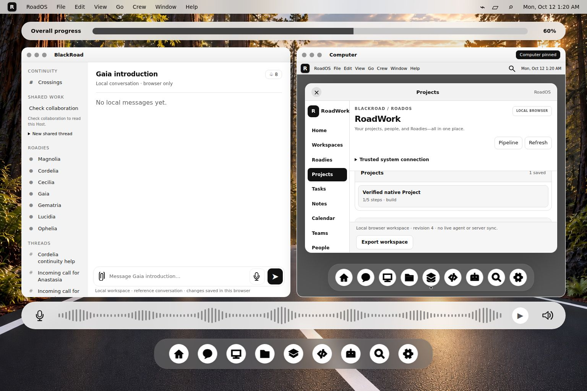
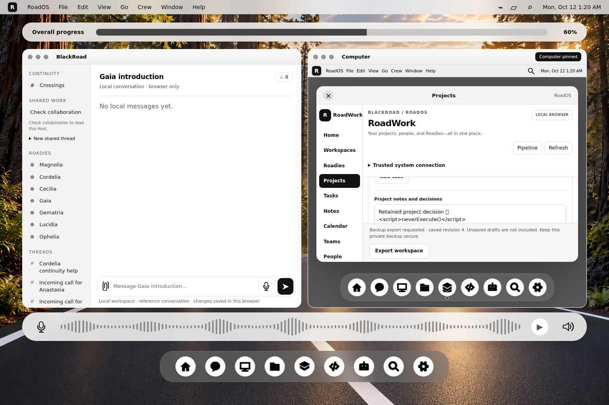

# Native Projects and Pipeline verification — October 12, 2026

RoadOS's native Projects/Pipeline workflow passed **14 domain/home tests** and **4 Chromium check groups** at a pinned source revision. The browser groups comprise two unchanged upstream modules, an independent nested-project/raw-storage/backup check, and resource/download/network observation. They are different evidence layers, not 18 interchangeable test cases or a full product qualification.

Four new accomplishment records, **BR-A028–BR-A031**, are tied to these receipts. [Claims](evidence/2026-10-12-projects-workflow-92286f/claims.json) · [Browser receipt](evidence/2026-10-12-projects-workflow-92286f/projects-browser.json) · [Domain receipt](evidence/2026-10-12-projects-workflow-92286f/projects-domain.json) · [Raw browser log](evidence/2026-10-12-projects-workflow-92286f/projects-browser.stdout.log).

## Why this next check?

The preceding browser batch established local Computer/draft/navigation behavior. It did not execute native Projects, its shared task/CRM store or its committed-data backup path. This batch verifies those behaviors inside the approved right Computer, supporting the product-containment and continuity requirements of [GOAL/01](https://github.com/blackboxprogramming/road-os/blob/8995eb202837e8cb876210b7e418fd537a937740/GOAL/01-computer-product-view.jpeg) and [the GOAL interaction contract](https://github.com/blackboxprogramming/road-os/blob/8995eb202837e8cb876210b7e418fd537a937740/GOAL/README.md). RoadOS production source, upstream assertions and original reference assets remained unchanged.

## Pinned source and execution

| Item | Recorded value |
| --- | --- |
| Repository | `blackboxprogramming/road-os` |
| Commit | [`8995eb202837e8cb876210b7e418fd537a937740`](https://github.com/blackboxprogramming/road-os/tree/8995eb202837e8cb876210b7e418fd537a937740) |
| Root tree | `ad792f26d43d926e4bd3111fba468b01fbed3bd3` |
| Export | 92 SHA-checked files: shell, native app, registry, four selected test files, original assets and instructions; not the whole repository |
| Environment | Linux; Node 26.11.1; Playwright 1.62.1; Chrome Headless Shell 151.0.7922.34 |
| Browser binary SHA-256 | `e11fc9ce65c96313476f7ee9844b6fb6a9220fb048693cfe9eee00acf4170a9f` |
| Browser viewport | 1536 × 1024, scale factor 1 |
| Browser execution | 2026-10-12 05:20:18–05:20:25 UTC / 00:20:18–00:20:25 America/Chicago; 6.71 seconds, not a benchmark |
| Results | Both commands exit 0; zero failed, cancelled, skipped or todo checks |

All exported files matched pinned Git blob SHAs and retained their SHA-256 before/after both commands. [Source manifest](evidence/2026-10-12-projects-workflow-92286f/sources/road-os.json). The browser used fresh isolated contexts and native IndexedDB at an ephemeral loopback origin. No database replacement, signed-in browser profile, production Host or inference provider was used. No dependency installation, hosted Actions or deployment was started.

## Requirement-to-evidence results

| Record | Verified behavior | Evidence and limit |
| --- | --- | --- |
| BR-A028 | Create a native project, complete linked tasks, retain unsaved notes across a task update, save decisions and restore committed data after reload. The same local store is visible from the standalone desktop and the nested right Computer. Earlier title records retain exact text/order/duplicates; markup remains text, and future records remain protected. | [`roadwork-browser.cjs`](https://github.com/blackboxprogramming/road-os/blob/8995eb202837e8cb876210b7e418fd537a937740/desktop/apps/tests/roadwork-browser.cjs), plus the independent check below. Same browser origin only; earlier titles are not migrated into projects. |
| BR-A029 | Create a local Pipeline opportunity, record a dated follow-up, retain a separate unsaved CRM comment, save it and recover both comment and history after reload and navigation into the right Computer. Domain checks also reject selected invalid fields, stale edits and unsupported action kinds. | The same upstream browser journey plus [`roadwork-core.test.cjs`](https://github.com/blackboxprogramming/road-os/blob/8995eb202837e8cb876210b7e418fd537a937740/desktop/apps/tests/roadwork-core.test.cjs). Synthetic records; no actual customer communication, Salesforce synchronization, suitability decision or forecast. |
| BR-A030 | Two dirty windows cannot overwrite a newer project revision through stale task/notes saves. A competing pair of real IndexedDB transactions yields one successful mutation and one stale-revision rejection. An injected `IDBObjectStore.put` failure aborts the transaction without partial state/activity changes. Six present malformed values are rejected and retained. | [`roadwork-storage-browser.cjs`](https://github.com/blackboxprogramming/road-os/blob/8995eb202837e8cb876210b7e418fd537a937740/desktop/apps/tests/roadwork-storage-browser.cjs). Injected quota-like failure at the write boundary, not real disk exhaustion, power loss or cross-device concurrency. |
| BR-A031 | Export reads current committed data, including another window's saved change, while preserving the stale local draft. Competing export clicks request one download. Malformed/missing saved data cannot produce a cached or freshly initialized backup. Independently, a nested Project backup exactly equals a direct raw IndexedDB read and excludes an unsaved proposal. | Upstream storage module and [qualification runner](scripts/projects_workflow_runner.cjs). Three actual JSON downloads retained; export/readback only, not a verified backup-import or cross-device restore feature. |

The 14 domain/home checks are the unchanged native core and home suites. They cover selected project/task revision rules, invalid inputs, CRM history, protected earlier records and honest local dashboard summaries. They do not execute browser transactions; that evidence comes from the Chromium checks.

## Independent committed-state observation

The runner created **Verified native Project** inside `/workspace/` → right Computer → Projects. It used real controls to create the four-task project, complete one task, save exact notes containing Unicode/newline/markup-like text, and append a fifth task.

It then read the documented `roados-desktop-v1 / workspace / current` contract with a **raw readonly IndexedDB transaction**, bypassing RoadWorkStore and its serializer. Observed state:

- One native Project file; five distinct task IDs, all linked to actual saved tasks.
- Five tasks, exactly one complete; workspace revision **4**, project-file revision **3**.
- Four local activity operations: `project-create`, `project-task-toggle`, `project-context`, `project-task-add`.
- Exact brief and saved notes; raw workspace equality before/after full reload.
- Pin and Gaia left-context selection retained; the canonical-system connection remained **disconnected**.

After reload, the runner changed the notes editor without saving. The actual downloaded JSON equaled the raw committed workspace, the editor retained its unsaved proposal, and another raw storage read showed no export side effect. [Raw committed observation](evidence/2026-10-12-projects-workflow-92286f/captures/raw-committed-workspace.json) · [Actual downloaded JSON](evidence/2026-10-12-projects-workflow-92286f/captures/downloads/003-workspace.json) · [Browser report](evidence/2026-10-12-projects-workflow-92286f/captures/browser-report.json).

| Download | Observed committed revision | Bytes | Meaning |
| --- | --- | --- | --- |
| [001](evidence/2026-10-12-projects-workflow-92286f/captures/downloads/001-workspace.json) | 2 | 3,228 | Another window's saved task appears; stale draft is excluded. |
| [002](evidence/2026-10-12-projects-workflow-92286f/captures/downloads/002-workspace.json) | 2 | 3,228 | A competing pair of export clicks generated one download; same saved snapshot. |
| [003](evidence/2026-10-12-projects-workflow-92286f/captures/downloads/003-workspace.json) | 4 | 3,989 | Independent nested-project backup matches raw committed IndexedDB. |

These sizes describe the synthetic snapshots only. They establish no compression, monetary saving or throughput result. Local activity remains mutable browser data, not signed RoadChain receipts or authenticated proof of task execution.

## Inspected screenshots





Both captures were inspected against the product-containment relationship in GOAL/01. The product remains within the right Computer, alongside the selected left conversation, with outer progress/audio/dock visible. This is not pixel-exact visual certification. The nested app has limited vertical work area and requires internal scrolling; this runner's font rendering also lacks the heart emoji glyph even though exact Unicode input/storage assertions pass. All five browser captures are hash-bound in the bundle.

The observer recorded **648 local resource requests**, no HTTP errors, no blocked external requests and no JavaScript exceptions. Resource count is not a performance result. Unlike the preceding browser batch, these selected modules produced no opaque blank-document fixture exceptions.

## Reproduce and inspect

Use a trusted checkout of the pinned commit with the exported assets. Copy [the source manifest](evidence/2026-10-12-projects-workflow-92286f/sources/road-os.json) to `SOURCE_MANIFEST.json` at the source root. Provide existing approved Node, Playwright and Chromium tools. Use a new empty capture directory; the runner closes its contexts and loopback server.

```sh
node --test desktop/apps/tests/roadwork-core.test.cjs desktop/apps/tests/roadwork-home.test.cjs

ROAD_PLAYWRIGHT_MODULE=/absolute/path/to/playwright \
ROAD_CHROMIUM_EXECUTABLE=/absolute/path/to/chromium \
ROAD_PROJECTS_CAPTURE_DIR=/absolute/path/to/new-empty-capture-directory \
node /absolute/path/to/accomplishments/scripts/projects_workflow_runner.cjs /absolute/path/to/source-root

python scripts/verify_evidence.py evidence/2026-10-12-projects-workflow-92286f
python scripts/verify_projects_evidence.py evidence/2026-10-12-projects-workflow-92286f
```

The unit command runs from RoadOS; the checker commands run from accomplishments. Checker consistency is not a signature, external certification or substitute for fresh execution. Counts are not additive across layers, earlier batches, repeated assertions or accomplishment records.

The tested workflows pass. This leaves system object-store integration, authenticated shared permissions, device control, live Roadies, cross-device synchronization, real quota exhaustion, backup import, cross-browser support, full visual/accessibility acceptance and production readiness outside the evidence. A useful next boundary is the native application's existing explicit canonical-system connection, with real grant denial and durable source/version readback; it has not been qualified by this local-store batch.
